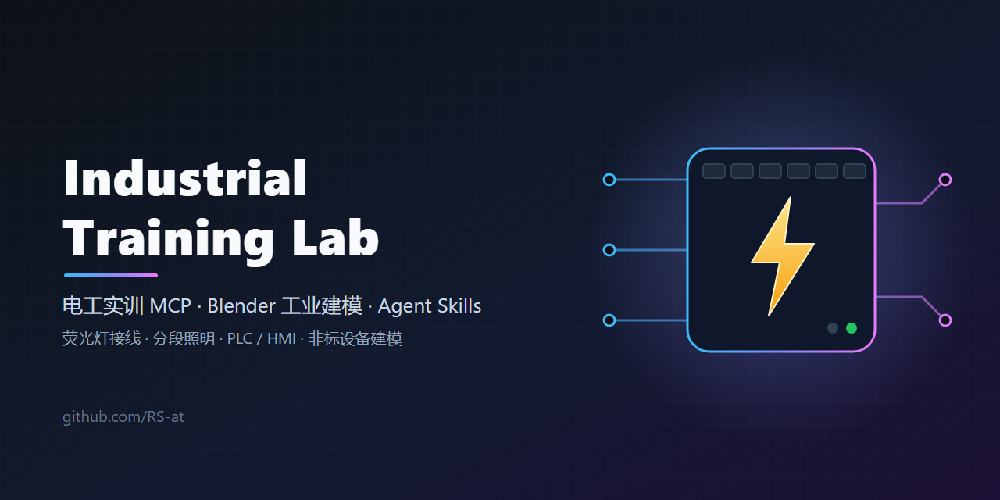

<p align="center">
  
</p>

# Industrial Training Lab

电工及工业自动化**教学实训**工具集：两个本地 MCP 服务端 + 一组 Agent Skills，可用于 Claude Code 和 Codex。

- **electrical_lab**（MCP）：荧光灯（电感镇流器 + 启辉器）接线校验与通电时序仿真、二路三段分段照明 + 独立插座回路、46 类工业设备教学目录、PLC/HMI 信号与标签校验、素材规格与非标设备建档。Python 标准库实现，无网络、无硬件 I/O；二路三段模型另需 Node.js。
- **industrial_blender**（MCP）：在单个 MCP 中接入 Blender 场景检查、多视角渲染、端子核验与接线、BLEND/GLB/PNG 导出，以及 DSH Blender 后端的完整 HTTP 接口。
- **skills/**：电工实训课件、三维电工实训、工业素材与非标建模、工业 Blender 工作流。

> ⚠️ 仅用于教学演示。不是 220V 交流瞬态仿真，**不能**用于指导未经审核的市电带电接线；实物接线前必须核对设备铭牌、厂家端子资料和学校安全规程。

## 目录结构

```
mcp/
  electrical_lab/        入口 mcp_combined.py（合并 current/ + modeling/ + two_route/）
    current/             v3 主包：荧光灯、工业目录、素材工具
    modeling/            v3 非标建档包（保留 5 个独有工具）
    two_route/           二路三段分段照明 + 独立插座教学模型（Node.js）
    conveyor/            S7-1200 传送带离线 HTML 演示（浏览器直接打开）
  industrial_blender/    入口 launch_mcp.py
skills/
  electrical-training/        电工及 PLC/HMI/机器人 HTML 实训课件
  electrical-lab-3d/          荧光灯实训的 Blender + Three.js 三维版
  industrial-assets/          实训素材规格、CPU/GPU 渲染策略
  industrial-asset-modeling/  非标设备建档、来源核验、示意 SVG
  industrial-blender-v3/      工业 Blender MCP 的使用流程
```

## electrical_lab

需要 Python 3.10+，无第三方 Python 依赖；二路三段工具另需 Node.js。共 26 个工具：

| 类别 | 工具 |
|---|---|
| 荧光灯实训 | `list_components` `get_fluorescent_lab` `validate_wiring` `simulate_fluorescent` `list_faults` |
| 二路三段照明 | `get_two_route_lab` `validate_two_route_wiring` `simulate_two_route` `list_two_route_faults` |
| 工业设备目录 | `list_device_categories` `search_industrial_devices` `get_industrial_device` `scaffold_industrial_lab` |
| PLC / HMI | `validate_signal_links` `validate_hmi_tags` |
| 素材与渲染 | `list_asset_sources` `new_asset_spec` `validate_asset_spec` `plan_render_pipeline` `generate_generic_svg` `simulate_motion_step` |
| 非标设备建档 | `list_material_sources` `get_asset_intake_checklist` `new_nonstandard_asset` `validate_asset_manifest` `render_nonstandard_svg` |

Claude Code（在仓库根目录的 `.mcp.json`，或 `~/.claude.json` 的 `mcpServers`）：

```json
{
  "mcpServers": {
    "electrical_lab": {
      "type": "stdio",
      "command": "python",
      "args": ["-X", "utf8", "<repo>/mcp/electrical_lab/mcp_combined.py"],
      "env": { "PYTHONUTF8": "1" }
    }
  }
}
```

测试：

```bash
cd mcp/electrical_lab/current && python -m pytest tests
```

## industrial_blender

需要 Blender 4.5、Node.js 20+、Python 3.10+（`mcp>=1.15,<2`）、Git，并能访问 GitHub。

1. 运行 `mcp/industrial_blender/BOOTSTRAP_DSH.ps1`：把上游 [dsh-blender-plugin](https://github.com/sixtysevenlf/dsh-blender-plugin) 完整克隆到 `vendor/` 并固定到 commit `82c588d`。本仓库**不重新分发**上游代码。
2. 在 Blender 中启用 `vendor/dsh-blender-plugin/addon/dsh_blender_bridge.py`，在侧边栏点 Connect（本机端口 9876）。
3. 安装依赖：`pip install "mcp>=1.15,<2"`（或在该目录 `uv sync`）。
4. 配置 MCP：

```json
{
  "mcpServers": {
    "industrial_blender": {
      "type": "stdio",
      "command": "python",
      "args": ["<repo>/mcp/industrial_blender/launch_mcp.py"],
      "env": { "BLENDER_EXE": "C:/path/to/blender.exe" }
    }
  }
}
```

`launch_mcp.py` 会在需要时启动本机 `127.0.0.1:9877` 的 DSH 后端，再启动 MCP。`/act`、`/headless` 可执行任意本地 Python，只在可信项目中使用。详见 [mcp/industrial_blender/README.md](mcp/industrial_blender/README.md)。

## Skills

把 `skills/` 下需要的文件夹复制到 `~/.claude/skills/`（Claude Code）或 `~/.codex/skills/`（Codex）。每个 skill 先读同目录的 `CLAUDE-ADAPTER.md`。Skill 中的 `<repo>`、`<BLENDER_EXE>`、`<local asset library>` 等占位符需要换成你自己的路径。

## 许可

本仓库以 [MIT](LICENSE) 许可发布（代码与文档由作者借助 Codex 编写）。第三方部分保留各自许可：

- `vendor/dsh-blender-plugin`：© sixtyseven67，BSD-3-Clause，安装时下载，不包含在本仓库。
- `mcp/industrial_blender/skills/blender-modeling`：MIT 许可项目的派生作品，保留原 `LICENSE` 和 `NOTICE.md`。
